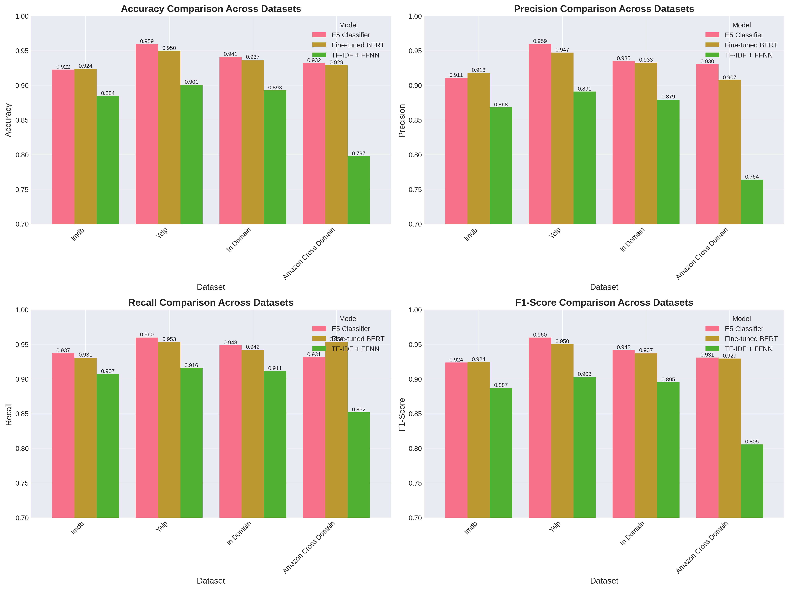

# Traditional Fine-tuning vs LoRA for Cross-Domain Sentiment Analysis

NTU SC4001 group project comparing full fine-tuning with domain-specific LoRA adapters joined by a fusion gate for sentiment classification, trained on IMDB and Yelp and tested cross-domain on Amazon reviews.

[](https://www.python.org/downloads/)
[](https://pytorch.org/)

[](https://opensource.org/licenses/MIT)



## What it does

Trains five sentiment classifiers on pooled IMDB and Yelp reviews and tests them in-domain and on Amazon reviews the models never saw. Method A is pooled training (TF-IDF + FFNN, frozen E5 + linear head, full BERT fine-tuning). Method B trains one LoRA adapter per domain on a frozen E5 backbone, combines them with a learned fusion gate, and adapts only that gate at test time with entropy minimisation (TENT). The fusion model reached 0.9482 Macro-F1 in-domain and 0.9427 on Amazon with under 1% of BERT's trainable parameters (full tables under [Results Summary](#-results-summary)).

## Tech

Python, PyTorch 2.1, Hugging Face Transformers and Datasets, PEFT (LoRA), Optuna, scikit-learn, Jupyter.

## Run

The guide further down refers to `train_all_models.py` and `train_method_b_e5.py`; in this repository those trainers are `fine_tuning/second.py` (Method A) and `lora/train.py` (Method B).

```bash
pip install -r requirements.txt

cd fine_tuning
jupyter notebook first.ipynb     # preprocessing; writes data/processed/ (already committed)
python second.py                 # Method A: TF-IDF, E5 and BERT baselines -> fine_tuning/models/
jupyter notebook third.ipynb     # evaluation and figures -> fine_tuning/outputs/

cd ../lora
python train.py                  # Method B: LoRA adapters, fusion gate, TENT -> lora/outputs/
python inference.py --text "Great value and it arrived early"   # needs the trained adapters
```

A CUDA GPU is recommended; trained checkpoints are not committed.

## SC4001: Neural Networks and Deep Learning - Academic Project

---

## 📋 Table of Contents

- [Overview](#-overview)
- [Research Questions](#research-questions)
- [Project Structure](#-project-structure)
- [Methodology](#methodology)
- [Installation](#-installation)
- [Usage](#-usage)
- [Results Summary](#-results-summary)
- [References](#-references)
- [Contributors](#-contributors)

---

## 🎯 Overview

This repository implements a rigorous comparative study of **traditional empirical risk minimization (ERM)** versus **parameter-efficient LoRA-based adaptation** for cross-domain sentiment classification. The work investigates how domain-specific lightweight adapters with fusion mechanisms compare to full fine-tuning under domain shift.

### Key Contributions

1. **Systematic Multi-Method Comparison**: Five model configurations spanning classical baselines to parameter-efficient domain adaptation
2. **Cross-Domain Robustness Evaluation**: Training on IMDB+Yelp, testing on Amazon product reviews
3. **Test-Time Adaptation**: Unsupervised entropy minimization (TENT) on fusion gates for target domain
4. **Rigorous Experimental Protocol**: Unified preprocessing, stratified K-fold CV, Optuna hyperparameter optimization (10-15 trials per model)
5. **Comprehensive Metrics**: Accuracy, Macro-F₁, ROC-AUC, Expected Calibration Error (ECE), confusion matrices

### Research Questions

> **RQ1**: How do pooled-source ERM methods compare with parameter-efficient, domain-specific LoRA adapters combined through a fusion gate on both in-domain and cross-domain sentiment classification?

> **RQ2**: Does adapting the fusion model using unsupervised test-time entropy minimization (TENT) improve generalization under domain shift?

### Datasets

We conduct experiments across three review domains with distinct linguistic characteristics:

- **IMDB**: Movie reviews (24k train, 6k eval, 6k test)
- **Yelp**: Restaurant reviews (24k train, 6k eval, 6k test)
- **Amazon**: Product reviews (6k test only - cross-domain evaluation)

**Total Sample Budget**: 
- Training: 48,000 samples (pooled IMDB + Yelp)
- In-domain validation: 12,000 samples
- Cross-domain test: 6,000 samples (Amazon)

All datasets use stratified sampling with balanced positive/negative labels and fixed random seed (42) for reproducibility.

## 📁 Project Structure

```
sentiment-analysis-sc4001/
├── README.md                          # This file
├── main.tex                           # Full academic report (LaTeX)
├── requirements.txt                   # Python dependencies
│
├── data/                              # Shared data directory
│   └── processed/                     # Preprocessed datasets
│       ├── train.json                 # Training: IMDB + Yelp (48k samples)
│       ├── eval.json                  # Validation: IMDB + Yelp (12k samples)
│       ├── imdb_eval.json             # In-domain test: IMDB (6k)
│       ├── yelp_eval.json             # In-domain test: Yelp (6k)
│       ├── amazon_eval.json           # Cross-domain test: Amazon (6k)
│       └── dataset_summary.json       # Dataset statistics
│
├── fine_tuning/                       # Method A: Pooled ERM Baselines
│   ├── first.ipynb                    # [1] Data preprocessing pipeline
│   ├── train_all_models.py            # [2] Unified training script (all baselines)
│   ├── third.ipynb                    # [3] Evaluation & visualization
│   ├── train_bert_only.py             # Standalone BERT trainer
│   ├── run_training.sh                # Bash wrapper for training
│   ├── TRAINING_README.md             # Detailed methodology documentation
│   ├── requirements.txt               # Method A dependencies
│   └── models/                        # Trained model checkpoints
│       ├── tfidf_ffnn/
│       ├── e5_classifier/
│       └── bert_finetuned/
│
└── lora/                              # Method B: LoRA + Domain Adaptation
    ├── train_method_b_e5.py           # LoRA training with domain fusion
    ├── models_e5.py                   # Model architectures (LoRA + fusion gate)
    ├── metrics_utils.py               # Evaluation utilities
    ├── inference.py                   # Inference script for trained models
    └── outputs/                       # LoRA checkpoints & metrics
        ├── domain_adapter_imdb.pt     # IMDB LoRA adapter
        ├── domain_adapter_yelp.pt     # Yelp LoRA adapter
        ├── fusion_model.pt            # Fusion gate weights
        └── metrics/                   # Training curves & metrics
```

## Methodology

(Note that under the fine_tuning subfolder, first refers to the pre-processing, second refers to the training script, and third refers to the evaluation ipynb) 

Our experimental design follows a rigorous protocol to ensure fair comparison and reproducibility:

### Unified Experimental Protocol

- **Preprocessing**: Shared tokenization, max length 256 tokens, fixed random seed
- **Optimization**: Optuna TPE sampler, 10-15 trials per model, stratified K-fold CV
- **Early Stopping**: Patience of 2-3 epochs on validation loss
- **Evaluation Metrics**: Accuracy, Macro-F₁, Precision, Recall, ROC-AUC, ECE
- **Hardware**: Single GPU workstation (CUDA-capable recommended)

### Method A: Pooled ERM Baselines

Three model variants representing standard empirical risk minimization on pooled IMDB+Yelp data:

#### 1. **TF-IDF + FFNN** (Classical Baseline)
```python
Architecture: TF-IDF vectorizer (unigram+bigram, 10k vocab) → MLP (2 layers, ReLU, dropout)
Trainable parameters: ~2.5M
Purpose: Classical non-neural baseline
```

#### 2. **Frozen E5 + Linear Classifier** (Embedding Baseline)
```python
Base model: intfloat/e5-small-v2 (33.4M params, frozen)
Architecture: E5 encoder (frozen) → Linear head (384 → 2)
Trainable parameters: ~770 (classifier only, < 0.01%)
Purpose: Transfer learning baseline with minimal adaptation
```

#### 3. **BERT Full Fine-Tuning** (Transformer Baseline)
```python
Base model: bert-base-uncased (110M params)
Architecture: BERT encoder → Classification head on [CLS] token
Trainable parameters: ~109.5M (all parameters updated)
Purpose: State-of-the-art full fine-tuning benchmark
```

**Training Details**:
- K-Fold CV: 3-fold (TF-IDF, E5) or 2-fold (BERT, due to compute)
- Optuna trials: 15 (TF-IDF), 12 (E5), 8 (BERT)
- Search space: Learning rate [1e-5, 1e-3], batch size {16, 32, 64, 128}, dropout [0.1, 0.5]
- Storage per checkpoint: ~440 MB (BERT), ~3 MB (E5), ~10 MB (TF-IDF)

---

### Method B: LoRA-based Parameter-Efficient Domain Adaptation

Our parameter-efficient approach consists of three stages:

#### Stage 1: Domain-Specific LoRA Adapters

Train lightweight low-rank updates to a frozen E5 backbone separately for each source domain:

```python
Base model: intfloat/e5-small-v2 (frozen, 33.4M params)
LoRA configuration:
  - Rank r: 8 (searched in {8, 16, 32})
  - Alpha: 16 (searched in {16, 32, 64})
  - Target modules: Query & Value attention projections
  - Dropout: 0.1 (searched in [0.05, 0.30])

Trainable parameters per adapter: ~295k (< 1% of base model)
Storage per adapter: ~1.2 MB
```

**Training per domain**:
- IMDB adapter: K-Fold CV (3-fold) + Optuna (10 trials) on IMDB data
- Yelp adapter: K-Fold CV (3-fold) + Optuna (10 trials) on Yelp data

#### Stage 2: Fusion Gate (Mixture-of-Experts)

Combine domain-specific experts through a learned weighted aggregation:

```python
Input: Frozen E5 representation h(x) ∈ ℝ³⁸⁴
Gate: MLP(h) → softmax → weights w_k ∈ Δ²
Output: ẑ(x) = Σ_k w_k(x) · z_k(x)  # weighted logit combination

Gate architecture:
  - Hidden size: {64, 128, 256} (searched)
  - Activation: ReLU + dropout [0, 0.3]
  - Trainable: Gate parameters φ only (~10²-10³ params)
  - Frozen: E5 backbone + both LoRA adapters
```

**Training**:
- Data: Pooled IMDB + Yelp (48k samples)
- K-Fold CV: 2-fold + Optuna (15 trials)
- Optimization: AdamW, learning rate searched

#### Stage 3: Test-Time Adaptation (TENT)

Unsupervised adaptation on unlabeled Amazon target domain:

```python
Loss: L_TENT(φ) = 𝔼_x[-Σ_c p̂_c(x;φ) log p̂_c(x;φ)]  # entropy minimization
Updates: φ ← φ - η∇_φ L_TENT  # gate parameters only
Frozen: E5 backbone + LoRA adapters

Configuration:
  - Unlabeled data: Amazon training set (24k samples, labels not used)
  - Learning rate: ~1e-4
  - Steps: 10-20 (evaluate after each step)
  - Strategy: Select best step by validation performance
```

**Key Innovation**: TENT updates only the lightweight fusion gate (~10³ parameters) while preserving all domain-specific knowledge in frozen adapters.

---

### Comparison Summary

| Aspect | Method A (ERM) | Method B (LoRA + Fusion) |
|--------|----------------|--------------------------|
| **Philosophy** | Pooled training on all source data | Domain-specific specialization + fusion |
| **Parameters (BERT)** | 109.5M trainable (100%) | 295k trainable (<1%) |
| **Parameters (E5)** | 770 trainable (linear head) | 295k + fusion gate (~10³) |
| **Storage** | ~440 MB per model | ~1.2 MB per adapter + gate |
| **Training time** | 2.5 hours (BERT) | ~1.5 hours (total pipeline) |
| **Modularity** | Monolithic | Composable domain experts |
| **Adaptation** | Retrain from scratch | TENT gate-only updates |

## 💻 Installation

### Prerequisites

- **OS**: Linux (Ubuntu 20.04+), macOS, or Windows with WSL2
- **Python**: 3.8 or higher
- **GPU**: CUDA-capable GPU with 12GB+ VRAM recommended for BERT training
- **RAM**: 16GB minimum (32GB recommended for full experiments)
- **Storage**: ~5GB for datasets and model checkpoints

### Step 1: Clone Repository

```bash
git clone <repository-url>
cd sentiment-analysis-sc4001
```

### Step 2: Create Virtual Environment

**Using conda (recommended)**:
```bash
conda create -n sentiment_sc4001 python=3.8
conda activate sentiment_sc4001
```

**Using venv**:
```bash
python -m venv venv
source venv/bin/activate  # On Windows: venv\Scripts\activate
```

### Step 3: Install Dependencies

**All methods (recommended for full reproduction)**:
```bash
pip install -r requirements.txt
```

**Method A only (Fine-tuning baselines)**:
```bash
cd fine_tuning
pip install -r requirements.txt
```

**Method B only (LoRA)**:
```bash
pip install torch transformers datasets peft optuna scikit-learn pandas numpy tqdm matplotlib
```

### Step 4: Verify Installation

```bash
python -c "import torch; print(f'PyTorch: {torch.__version__}'); print(f'CUDA available: {torch.cuda.is_available()}')"
python -c "import transformers; print(f'Transformers: {transformers.__version__}')"
python -c "import peft; print(f'PEFT (LoRA): {peft.__version__}')"
python -c "import optuna; print(f'Optuna: {optuna.__version__}')"
```

Expected output should confirm all libraries are installed without errors.

## 🚀 Usage

### Complete Experimental Pipeline

Follow these steps to reproduce all experiments from data preprocessing through final evaluation:

#### Step 1: Data Preprocessing

```bash
cd fine_tuning
jupyter notebook first.ipynb
```

**What this does**:
- Downloads IMDB, Yelp, and Amazon review datasets
- Applies stratified sampling (30k samples per domain)
- Balances classes (50/50 positive/negative)
- Creates train/val/test splits with fixed seed
- Outputs to `data/processed/`

**Expected outputs**:
- `train.json` (48k samples: IMDB + Yelp)
- `eval.json` (12k samples: validation set)
- `imdb_eval.json`, `yelp_eval.json` (in-domain test, 6k each)
- `amazon_eval.json` (cross-domain test, 6k)
- `dataset_summary.json` (statistics)

---

#### Step 2: Train Method A Baselines

**All three baselines** (TF-IDF, E5, BERT):
```bash
cd fine_tuning
python train_all_models.py 2>&1 | tee training_log.txt
```

**Specific models**:
```bash
# TF-IDF baseline only (~30 min)
python train_all_models.py --models tfidf

# E5 classifier only (~25 min)
python train_all_models.py --models e5

# BERT full fine-tuning only (~2.5 hours)
python train_all_models.py --models bert
# Or use the dedicated script:
python train_bert_only.py

# Combination
python train_all_models.py --models e5 bert
```

**Custom hyperparameter search**:
```bash
# More thorough search (longer training time)
python train_all_models.py --n-trials 20

# Reduced search for testing
python train_all_models.py --n-trials 3 --models tfidf

# Skip Optuna and use saved hyperparameters
python train_all_models.py --skip-optuna
```

**Expected training times** (with GPU):
| Model | Trials | CV Folds | Approx. Time |
|-------|--------|----------|--------------|
| TF-IDF + FFNN | 15 | 3 | 20-40 min |
| E5 + Linear | 12 | 3 | 15-30 min |
| BERT Full FT | 8 | 2 | 1.5-3 hours |

**Outputs**:
- Model checkpoints: `models/{tfidf_ffnn, e5_classifier, bert_finetuned}/`
- Training logs: `training_YYYYMMDD_HHMMSS.log`
- Best hyperparameters: `models/*/best_hyperparameters.json`

---

#### Step 3: Train Method B (LoRA + Fusion)

```bash
cd lora
python train_method_b_e5.py 2>&1 | tee lora_training_log.txt
```

**Training stages** (automatic sequential execution):

1. **Stage 1: IMDB LoRA Adapter**
   - K-Fold CV (3-fold) + Optuna (10 trials)
   - Output: `outputs/domain_adapter_imdb.pt`
   - Time: ~30-45 min

2. **Stage 2: Yelp LoRA Adapter**
   - K-Fold CV (3-fold) + Optuna (10 trials)
   - Output: `outputs/domain_adapter_yelp.pt`
   - Time: ~30-45 min

3. **Stage 3: Fusion Gate Training**
   - K-Fold CV (2-fold) + Optuna (15 trials)
   - Output: `outputs/fusion_model.pt`
   - Time: ~20-30 min

**Total pipeline time**: ~1.5-2 hours

**Custom options**:
```bash
# Reduced trials for faster testing
python train_method_b_e5.py --n_trials 5

# Custom output directory
python train_method_b_e5.py --output_dir custom_outputs

# Skip stages if adapters already exist
python train_method_b_e5.py --skip_imdb  # Use existing IMDB adapter
python train_method_b_e5.py --skip_yelp  # Use existing Yelp adapter
```

**Outputs**:
- LoRA adapters: `outputs/domain_adapter_{imdb,yelp}.pt`
- Fusion gate: `outputs/fusion_model.pt`
- Training metrics: `outputs/metrics/`
- Best hyperparameters: `outputs/best_hyperparameters_{imdb,yelp,fusion}.json`

---

#### Step 4: Evaluation and Comparison

```bash
cd fine_tuning
jupyter notebook third.ipynb
```

**What this does**:
- Loads all trained models (Method A + Method B)
- Evaluates on in-domain test sets (IMDB, Yelp)
- **Cross-domain evaluation** on Amazon
- Applies TENT adaptation for Method B on Amazon
- Generates comparison tables and visualizations

**Generated outputs**:
- Performance comparison tables: `outputs/evaluation/comparison_table.csv`
- Confusion matrices: `outputs/evaluation/confusion_matrix_*.png`
- ROC curves: `outputs/evaluation/roc_curves.png`
- TENT trajectory plots: `outputs/evaluation/tent_trajectory_*.pdf`
- Domain adaptation analysis: `outputs/evaluation/domain_shift_analysis.json`

---

### Quick Test Mode (Reduced Experiments)

For faster testing or debugging:

```bash
# Method A with minimal trials
cd fine_tuning
python train_all_models.py --n-trials 3 --models tfidf

# Method B with minimal trials
cd ../lora
python train_method_b_e5.py --n_trials 3
```

This completes in ~30-45 minutes total but may yield suboptimal hyperparameters.

## 📊 Results Summary

### In-Domain Performance (IMDB + Yelp Test Sets)

Performance averaged across IMDB and Yelp held-out test sets:

| Model | Accuracy | Precision | Recall | Macro-F₁ | ROC-AUC | Params |
|-------|----------|-----------|--------|----------|---------|--------|
| **Method A: Pooled ERM** | | | | | | |
| TF-IDF + FFNN | 0.8930 | 0.8790 | 0.9110 | 0.8950 | 0.9450 | 2.5M |
| E5 (frozen) + FFN | 0.9410 | 0.9350 | 0.9480 | 0.9414 | 0.9838 | 770 |
| BERT (Full FT) | 0.9370 | 0.9330 | 0.9420 | 0.9370 | 0.9822 | 109.5M |
| **Method B: LoRA + Fusion** | | | | | | |
| **Fusion (pre-TENT)** | **0.9483** | **0.9482** | **0.9483** | **0.9482** | **0.9844** | **295k** |

**Key Findings**:
- ✅ **Fusion model achieves best in-domain performance** across all metrics
- ✅ Outperforms BERT full fine-tuning (+1.1 pp Macro-F₁) with **<1% parameters**
- ✅ Outperforms frozen E5 baseline (+0.7 pp Macro-F₁) through domain specialization
- ✅ ROC-AUC effectively saturated (>0.98) for all transformer-based methods

---

### Cross-Domain Performance (Amazon Test Set)

Generalization to unseen product review domain (trained on movies + restaurants):

| Model | Accuracy | Precision | Recall | Macro-F₁ | ROC-AUC | Drop from In-Domain |
|-------|----------|-----------|--------|----------|---------|---------------------|
| **Method A: Pooled ERM** | | | | | | |
| TF-IDF + FFNN | 0.7970 | 0.7640 | 0.8520 | 0.8050 | 0.8865 | -9.0 pp |
| E5 (frozen) + FFN | 0.9320 | 0.9300 | 0.9310 | 0.9310 | 0.9804 | -1.0 pp |
| BERT (Full FT) | 0.9290 | 0.9070 | 0.9620 | 0.9290 | 0.9732 | -0.8 pp |
| **Method B: LoRA + Fusion** | | | | | | |
| **Fusion (pre-TENT)** | **0.9428** | **0.9429** | **0.9426** | **0.9427** | **0.9833** | **-0.55 pp** |

**Key Findings**:
- ✅ **Fusion model shows best cross-domain generalization** (smallest performance drop)
- ✅ Outperforms BERT full fine-tuning on Amazon (+1.4 pp Macro-F₁)
- ✅ Domain-specific adapters + fusion → better robustness under shift
- ✅ Frozen E5 representations provide strong transfer baseline

---

### Test-Time Adaptation (TENT on Amazon)

Unsupervised adaptation via gate-only entropy minimization on unlabeled Amazon data:

| Snapshot | Step | Accuracy | Macro-F₁ | ROC-AUC | Δ from Pre-TENT |
|----------|------|----------|----------|---------|-----------------|
| Pre-TENT (Fusion) | 0 | 0.9428 | 0.9427 | 0.9833 | — |
| TENT Step 1 | 1 | 0.9433 | 0.9432 | 0.9836 | +0.05 pp |
| **TENT Best** | **2** | **0.9435** | **0.9433** | **0.9837** | **+0.07 pp** |
| TENT Step 3+ | 3+ | ↓ | ↓ | ↓ | *over-adaptation* |

**Key Findings**:
- ✅ TENT improves cross-domain performance with **no target labels**
- ✅ Best results after 2 adaptation steps (~0.07 pp gain)
- ⚠️ Over-adaptation beyond step 2 → performance degradation
- ✅ Updates only ~10³ gate parameters (E5 + adapters frozen)

**Practical Insight**: Early stopping on a small validation set crucial to prevent over-adaptation.

---

### Efficiency Comparison

| Metric | BERT Full FT | Fusion (LoRA) | Advantage |
|--------|--------------|---------------|-----------|
| **Trainable Parameters** | 109.5M (100%) | 295k (<1%) | **370× fewer** |
| **Model Storage** | ~440 MB | ~1.2 MB/adapter | **366× smaller** |
| **Training Time** | ~2.5 hours | ~1.5 hours | **1.7× faster** |
| **GPU Memory (Training)** | ~12 GB | ~4 GB | **3× less** |
| **In-Domain Macro-F₁** | 0.9370 | 0.9482 | +1.1 pp |
| **Cross-Domain Macro-F₁** | 0.9290 | 0.9427 | +1.4 pp |

**Conclusion**: LoRA-based fusion achieves **superior performance** with **<1% parameters**, **1.7× faster training**, and **366× smaller storage** compared to full fine-tuning.

---

### Error Analysis (Amazon Domain)

Failure patterns observed in cross-domain evaluation:

1. **Mixed Sentiment Reviews** (45% of errors)
   - Reviews with balanced positive/negative aspects
   - Model tracks local polarity but misses overall verdict
   - Example: "Great product, but too expensive and broke quickly"

2. **Sarcasm and Irony** (25% of errors)
   - Literal sentiment contradicts pragmatic meaning
   - Example: "Oh wonderful, another defective unit. Just what I needed."

3. **Discourse Structure** (15% of errors)
   - Positive opening → negative conclusion (or vice versa)
   - Model anchors on early sentences

4. **Content vs. Product Mismatch** (10% of errors)
   - Praise for content (e.g., book story) vs. criticism of product (e.g., binding quality)

5. **Label Noise** (5% of errors)
   - Clear positive reviews mislabeled as negative in dataset

**Implication**: Further gains require discourse-level modeling and pragmatic reasoning beyond current token-level architectures.

### Key Results for Report

**Main Findings to Highlight**:

1. **Performance**: LoRA fusion outperforms full BERT fine-tuning on both in-domain (+1.1 pp) and cross-domain (+1.4 pp) evaluations

2. **Efficiency**: Achieves superior results with <1% trainable parameters (295k vs 109.5M), 1.7× faster training, and 366× smaller storage

3. **Robustness**: Smallest performance degradation under domain shift (-0.55 pp vs -0.8 pp for BERT)

4. **Adaptation**: Test-time entropy minimization (TENT) provides small but consistent gains (+0.07 pp) with zero target labels

5. **Modularity**: Domain-specific LoRA adapters enable flexible composition and adaptation without catastrophic forgetting

**Recommended Visualizations** (from `third.ipynb`):
- Table 4: In-domain performance comparison
- Table 5: Cross-domain performance on Amazon
- Table 6: TENT adaptation trajectory
- Figure 4: Model comparison bar charts
- Confusion matrices (Appendix)

---

### Experimental Validation

To validate our results:

1. **Quick validation** (~1 hour):
   ```bash
   # Use provided checkpoints and evaluate
   cd fine_tuning
   jupyter notebook third.ipynb  # Run evaluation cells
   ```

2. **Full reproduction** (~5-6 hours):
   ```bash
   # Retrain all models from scratch
   cd fine_tuning
   python train_all_models.py --n-trials 10
   cd ../lora
   python train_method_b_e5.py --n_trials 10
   cd ../fine_tuning
   jupyter notebook third.ipynb  # Evaluate
   ```

3. **Expected metric ranges** (within ±0.3 pp):
   - BERT Full FT: Accuracy 0.934-0.940 (in-domain)
   - Fusion (LoRA): Accuracy 0.945-0.951 (in-domain)
   - Fusion on Amazon: Accuracy 0.940-0.946 (cross-domain)

---

### Hardware Requirements for Reproduction

**Minimum Configuration**:
- GPU: 8GB VRAM (can train E5 and LoRA models)
- RAM: 16GB
- Storage: 3GB
- Time: ~4-5 hours

**Recommended Configuration** (used in our experiments):
- GPU: NVIDIA A100/V100 or equivalent (12GB+ VRAM)
- RAM: 32GB
- Storage: 5GB
- Time: ~3-4 hours

**Without GPU**:
- TF-IDF and E5 models can train on CPU (~2-3× slower)
- BERT full fine-tuning not recommended on CPU (>24 hours)

## 📖 References

### Key Papers and Theoretical Foundations

**Parameter-Efficient Fine-Tuning**:
- Hu et al., "LoRA: Low-Rank Adaptation of Large Language Models", *ICLR 2022*
- Houlsby et al., "Parameter-efficient transfer learning for NLP", *ICML 2019*
- Pfeiffer et al., "AdapterFusion: Non-destructive task composition for transfer learning", *EACL 2021*

**Pre-trained Language Models**:
- Devlin et al., "BERT: Pre-training of Deep Bidirectional Transformers for Language Understanding", *NAACL 2019*
- Wang et al., "Text Embeddings by Weakly-Supervised Contrastive Pre-training" (E5), *arXiv:2405.01089*, 2024
- Reimers & Gurevych, "Sentence-BERT: Sentence Embeddings using Siamese BERT-Networks", *EMNLP 2019*

**Domain Adaptation Theory**:
- Ben-David et al., "A theory of learning from different domains", *Machine Learning*, 2010
- Blitzer et al., "Domain adaptation for sentiment classification", *ACL 2007*
- Wang et al., "Tent: Fully test-time adaptation by entropy minimization", *ICLR 2021*

**Mixture-of-Experts**:
- Jacobs et al., "Adaptive mixtures of local experts", *Neural Computation*, 1991
- Fedus et al., "Switch Transformers: Scaling to trillion parameter models", *arXiv:2101.03961*, 2021

### Datasets

- **IMDB**: Maas et al., "Learning Word Vectors for Sentiment Analysis", *ACL 2011*
- **Yelp**: Yelp Dataset Challenge (https://www.yelp.com/dataset)
- **Amazon**: McAuley et al., "Inferring networks of substitutable and complementary products", *KDD 2015*

### Software and Libraries

- **PyTorch**: Paszke et al., "PyTorch: An imperative style, high-performance deep learning library", *NeurIPS 2019*
- **Transformers**: Wolf et al., "Transformers: State-of-the-art natural language processing", *EMNLP 2020*
- **PEFT**: Hugging Face PEFT library (https://github.com/huggingface/peft)
- **Optuna**: Akiba et al., "Optuna: A next-generation hyperparameter optimization framework", *KDD 2019*
- **scikit-learn**: Pedregosa et al., "Scikit-learn: Machine learning in Python", *JMLR 2011*

---

## 👥 Contributors

**Project Team**:
- Ganesh Rudra Prasadh
- Chidambaram Aditya Somasundaram
- Pahwa Ronak

**Course Information**:
- **Course**: SC4001 - Neural Networks and Deep Learning
- **Institution**: Nanyang Technological University
- **School**: College of Computing and Data Science
- **Academic Year**: 2025-26
- **Submission Date**: 14 November, 2025

---

## Appendix: Quick Reference Commands

### Setup
```bash
# Environment setup
conda create -n sentiment_sc4001 python=3.8
conda activate sentiment_sc4001
pip install -r requirements.txt
```

### Training
```bash
# Method A (all baselines)
cd fine_tuning
python train_all_models.py

# Method B (LoRA + fusion)
cd lora
python train_method_b_e5.py
```

### Evaluation
```bash
# Complete evaluation and visualization
cd fine_tuning
jupyter notebook third.ipynb
```

### File Structure Check
```bash
# Verify all required files present
ls data/processed/*.json
ls fine_tuning/models/*/best_*.pt
ls lora/outputs/*.pt
```

---
